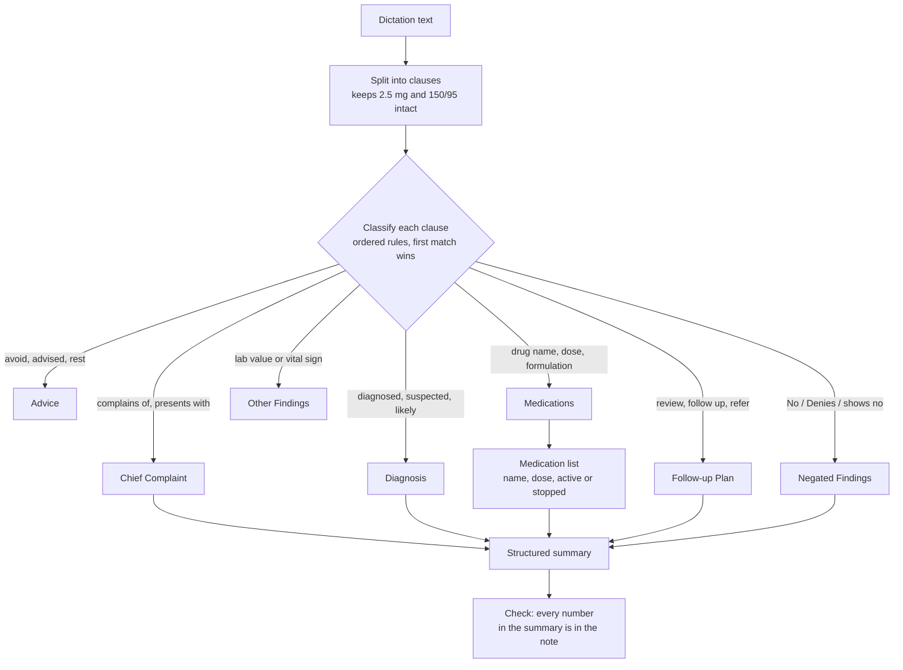

# Clinical NLP Demo

Turns a doctor's free-text dictation into structured clinical sections (chief complaint, diagnosis, medications, follow-up), a medication list with doses, and a summary that is checked for invented numbers. Rule-based and fully explainable, with a labelled evaluation set and a baseline comparison.


> **Synthetic data only.** Every note in this repository was written for testing. Do not enter real patient data. This is a portfolio project, not a medical device.

---

## Contents

1. [Example](#example)
2. [Results](#results)
3. [Quick start](#quick-start)
4. [How it works](#how-it-works)
5. [Evaluation method](#evaluation-method)
6. [Project structure](#project-structure)
7. [What failed and what I changed](#what-failed-and-what-i-changed)
8. [Limitations and next steps](#limitations-and-next-steps)

---

## Example

**Input**

```text
Woman with burning pain in upper abdomen after meals. No vomiting. Impression gastritis.
Pantoprazole 40 mg before breakfast for 4 weeks. Avoid spicy food and NSAIDs. Review after 1 month.
```

**Output**

| Section | Extracted |
| --- | --- |
| Chief Complaint | Woman with burning pain in upper abdomen after meals |
| Negated Findings | No vomiting |
| Diagnosis | Impression gastritis |
| Medications | pantoprazole, 40 mg, active |
| Advice | Avoid spicy food and NSAIDs |
| Follow-up Plan | Review after 1 month |

**Summary:** Presents with burning pain in upper abdomen after meals. Negatives: no vomiting. Assessment: impression gastritis. Medications: pantoprazole 40 mg. Plan: review after 1 month.

The app also shows which rule placed each sentence, so every decision can be checked.

---

## Results

Scores on a **held-out test set of 20 synthetic notes**, comparing the first version of the rules (v1) with the current version (v2). Full reports are in [`results/`](results).

| Section | v1 precision | v1 recall | v1 F1 | v2 precision | v2 recall | v2 F1 |
| --- | --- | --- | --- | --- | --- | --- |
| Chief Complaint | 0.47 | 0.74 | 0.57 | 0.95 | 1.00 | 0.97 |
| Diagnosis | 0.94 | 0.80 | 0.86 | 1.00 | 0.90 | 0.95 |
| Medications | 0.77 | 0.75 | 0.76 | 0.96 | 1.00 | 0.98 |
| Follow-up Plan | 0.56 | 0.91 | 0.69 | 0.95 | 1.00 | 0.98 |
| **Micro average** | **0.64** | **0.80** | **0.71** | **0.97** | **0.98** | **0.97** |

- **Negation:** v1 listed 6 of 9 negated findings ("No fever", "Denies blood in stool") as complaints. v2 lists 0 of 9.
- **Medication list (v2):** 26 of 26 drug names found with correct doses.
- **Unknown drug names (stress test):** with every test-set drug removed from the drug list, name F1 is 0.94 and dose accuracy 1.00 ([report](results/test_unseen_drugs.md)).

**Read these numbers with care.** I wrote both the rules and the notes, the notes are short and tidy, and the drug list contains every drug in the test set. Real dictations (speech-to-text errors, abbreviations, long rambling notes) would score lower. The value of the table is the v1 vs v2 comparison on the same data, not the absolute numbers.

---

## Quick start

### Prerequisites

Python 3.10 or newer (`python --version`) and Git.

### Run the app

```bash
git clone https://github.com/jeevanraj-28/Clinical-NLP-Demo.git
cd Clinical-NLP-Demo

python -m venv .venv
# Windows: .venv\Scripts\activate
source .venv/bin/activate

pip install -r requirements.txt
streamlit run app.py
```

Open **http://localhost:8501**, pick an example note from the dropdown and click **Structure note**.

### Optional: model-based summaries

The rule-based app needs only Streamlit. To also get abstractive summaries from DistilBART (about 1 GB download on first use):

```bash
pip install -r requirements-model.txt
```

A "Model (DistilBART)" option then appears in the app. Its output is checked for numbers that are not in the note.

### Run the evaluation and tests

```bash
python evaluate.py                  # held-out test set, v1 vs v2
python evaluate.py --errors         # also list every remaining mistake
python evaluate.py --unseen-drugs   # stress test with test drugs removed from the drug list
python evaluate.py --split dev      # development set

python -m unittest discover -s tests -v
```

None of these need PyTorch or Transformers.

### Run with Docker

```bash
docker build -t clinical-nlp .                       # rules only, small image
docker build --build-arg WITH_MODEL=1 -t clinical-nlp .  # with DistilBART
docker run -p 8501:8501 clinical-nlp
```

### Deploy to Hugging Face Spaces

1. Create a new Space with the **Streamlit** SDK.
2. Upload `app.py`, `requirements.txt` (or `requirements-model.txt` renamed to `requirements.txt` for model summaries), the `clinical_nlp/` folder and the `data/` folder.
3. Add this block at the very top of the Space's README:

```yaml
---
title: Clinical NLP Demo
emoji: 🩺
colorFrom: blue
colorTo: indigo
sdk: streamlit
sdk_version: 1.37.1
app_file: app.py
license: mit
---
```

---

## How it works



**1. Split into clauses.** Sentences split on full stops, semicolons and new lines; then on commas. A full stop inside a number ("2.5 mg") does not split. A comma fragment starting with a digit ("4 tablets daily") joins the fragment before it.

**2. Classify each clause into exactly one section.** Rules are checked in a fixed order and the first match wins. Order matters:
- Negation is checked first, so "No fever" never becomes a complaint.
- Follow-up comes before advice, so "Maintain a diary and review in 4 weeks" is a follow-up.
- An explicit presentation phrase ("Patient has dry cough after starting enalapril") is a complaint even though it mentions a drug.
- Lab values with units such as mg/dl ("Fasting sugar 182 mg/dl") are kept out of Medications.

**3. Build the medication list.** Drug names come from a list of 110 common generic drugs. If no listed drug is found, the word before a dose ("zentoprazine 20 mg") is taken as the name. Doses are normalised ("500mg" → "500 mg"). A later instruction overrides an earlier one ("Increase metformin to 1000 mg"), and "Stop enalapril" marks that drug as stopped.

**4. Summarise.** The default summary is assembled from the extracted fields, so it cannot invent anything. The optional DistilBART summary reads more naturally, but the model was trained on news articles and can drop or change details. Both are checked: any number in the summary that is not in the note is flagged in red.

### Why rules instead of a trained model?

| | Rules (this project) | Fine-tuned NER model |
| --- | --- | --- |
| Labelled data needed | None | Hundreds to thousands of annotated notes |
| Explainability | Every decision traces to one rule | Hard to explain single predictions |
| Handles unseen phrasing | Poorly | Well |
| Safe for a public demo | Yes, no patient data or model training | Needs real clinical data to train well |

Rules are the right first step here: they create a measurable baseline and a labelled test set. A model should beat that baseline on the same test set before it replaces the rules.

---

## Evaluation method

**Data.** [`data/test_notes.jsonl`](data/test_notes.jsonl) has 20 synthetic notes; [`data/dev_notes.jsonl`](data/dev_notes.jsonl) has 10. Each note lists, for every section, the key phrases that must appear there, plus negated findings and the expected drugs with doses.

```json
{"id": "t01", "note": "Patient complains of burning sensation while passing urine for 4 days. No fever. ...",
 "gold": {"Chief Complaint": ["burning sensation while passing urine"], "Diagnosis": ["urinary tract infection"], ...},
 "negated": ["fever"],
 "meds": [{"name": "nitrofurantoin", "dose": "100 mg"}]}
```

**Process.** The test set was written before the v2 rules, and the rules were developed on the dev set. The test set was run once for the reported numbers. After that, the unseen-drug stress test exposed one bug, which was fixed (see below); that fix changed only the stress-test score.

**Metrics.** For each section:
- **Precision:** extracted items that contain a gold phrase for that section, divided by all extracted items in the section.
- **Recall:** gold phrases found in the section, divided by all gold phrases.
- **F1:** the harmonic mean of the two. The micro average pools counts across the four core sections.

---

## Project structure

```
Clinical-NLP-Demo/
├── app.py                    # Streamlit UI
├── clinical_nlp/
│   ├── extractor.py          # v2: clause splitting, ordered rules, medication list
│   ├── lexicon.py            # All word lists in one place (symptoms, drugs, cues)
│   ├── summarizer.py         # Structured and DistilBART summaries + number check
│   └── baseline.py           # v1 rules, unchanged, kept for comparison
├── data/
│   ├── dev_notes.jsonl       # 10 notes used while writing the rules
│   └── test_notes.jsonl      # 20 held-out notes
├── evaluate.py               # Precision / recall / F1, v1 vs v2, stress test
├── results/                  # Saved reports and per-note error lists
├── tests/test_extractor.py   # 19 unit and regression tests
├── requirements.txt          # Streamlit only
├── requirements-model.txt    # + transformers, torch for DistilBART
└── Dockerfile
```

---

## What failed and what I changed

| Problem in v1 | Example | Fix in v2 |
| --- | --- | --- |
| Negations treated as symptoms | "No fever" listed as a complaint (6 of 9 negations wrong) | Negation cues checked before everything else |
| One sentence in several sections | "Cough for 3 weeks" was both a complaint and a follow-up, because of "weeks" | Ordered rules, one section per clause |
| Decimals split apart | "Prednisolone 2.5 mg" broken at the decimal point | Split only on full stops not followed by a digit |
| Advice treated as a prescription | "Avoid ibuprofen" listed under Medications | Separate Advice section, checked before medications |
| Lab units mistaken for doses | "182 mg/dl" looked like a dose | Dose pattern excludes "/dl" and "/l" |

Two bugs were found by the tests and the stress test while building v2:

- **Sentence merge after numbers.** "Blood pressure 160/100. Assessment: …" stayed one clause, because a full stop after a digit was not treated as a sentence end. A unit test caught it.
- **Formulation word taken as the drug name.** With a drug missing from the list, "Salbutamol inhaler 2 puffs" gave the name "inhaler". The stress test showed it (unknown-drug F1 0.82); excluding formulation and route words from the fallback raised it to 0.94.

---

## Limitations and next steps

**Remaining mistakes on the test set** (`python evaluate.py --errors`):
- "ACE inhibitor induced cough" is a diagnosis but is filed as a complaint because it contains "cough".
- "Follow-up visit for hypertension" is filed only as follow-up, so the diagnosis is missed.
- A medication history line ("Known diabetic on metformin 500 mg") is listed with the current plan.
- Multi-word drug names missing from the list ("oral rehydration solution") are not recovered by the fallback.

**Next steps**
- [ ] Collect 100+ realistic synthetic notes, including speech-to-text errors and abbreviations (BD, TDS, OD)
- [ ] Fine-tune a biomedical NER model and compare it with these rules on the same test set
- [ ] Separate medication history from the current plan
- [ ] Audio input: Whisper transcription, then this pipeline

---

## Author

**Jeevan Raj M** · [LinkedIn](https://linkedin.com/in/jeevan-raj-m-5ba64a383) · [GitHub](https://github.com/jeevanraj-28) · [Portfolio](https://jeevanraj-28.github.io)

All notes are synthetic. No real patient data and no proprietary code from any employer is used in this repository.
